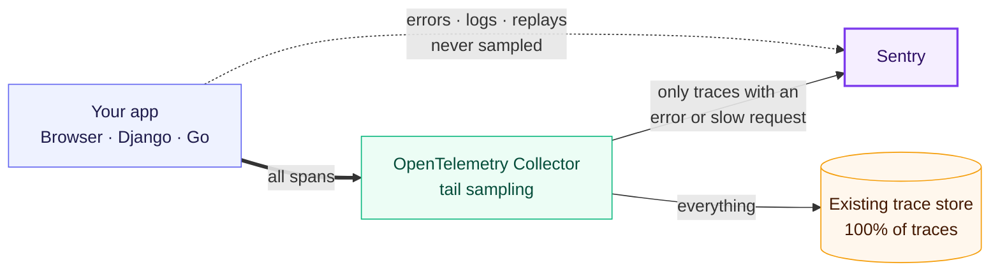
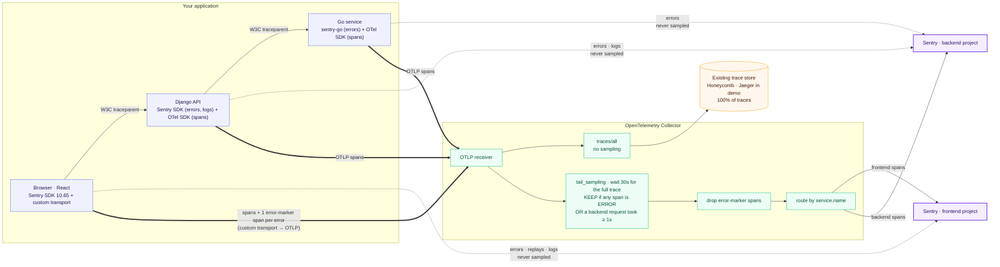

# Tail-sampling demo: Sentry + OpenTelemetry Collector

This demo sends **every trace that contains an error anywhere (browser or backend), or that has a slow backend request, to Sentry as one complete frontend + backend trace**. **All** traces still go to your existing trace store. Jaeger stands in for that store here.

Errors, logs and replays go straight to Sentry and are never sampled.

## Architecture



<details><summary>Detailed view: every component and connection</summary>



</details>

**How to read it:** dotted lines are errors, logs and replays. They go straight to Sentry and are never sampled. Thick lines are spans. Every span goes to one collector, which sends 100% to your existing trace store and holds each trace until it's complete. It then forwards to Sentry only the traces that contain an error anywhere, or a slow backend request.

<details><summary>Text version</summary>

```
Browser (React, @sentry/react 10.65.0 + spanStreamingIntegration)
  ├─ errors / replays / logs ──────────────────────────────────────────► Sentry  (FE project)
  └─ spans ─► OTLP split transport ─► OTLP/HTTP JSON ─► /otlp (same origin) ─┐
              └─ + one "error marker" span per captured error              │ nginx
                                                                            ▼
Django API ── sentry-sdk: errors + logs (OTel trace ids) ─────────────────► Sentry  (BE project)
  │   └─ OTel SDK (django, psycopg, requests) ── OTLP ───────────────────┐
  ▼  W3C traceparent                                                      │
Go replica ── sentry-go: errors (OTel trace ids) ────────────────────────► Sentry  (BE project)
      └─ OTel SDK + otelhttp ── OTLP ───────────────────────────────────┐ │
                                                                         ▼ ▼
                         OTel Collector (otelcol-contrib 0.120.0)
                           receiver otlp :4317 / :4318
                           ├─ traces/all    : batch ─────────────────────► Jaeger  (100 %)
                           └─ traces/sentry : tail_sampling (ERROR | slow SERVER span | [test] force_keep)
                                              → filter (drop sentry.error_marker)
                                              → routing by service.name
                                                   ├─ demo-frontend ─► otlphttp ─► Sentry FE (OTLP)
                                                   └─ everything else ─► otlphttp ─► Sentry BE (OTLP)
```

</details>

| Service | Port | Purpose |
|---|---|---|
| `nginx` | http://localhost:8080 | Demo UI. Serves `/`, proxies `/api` and `/graphql` to Django and `POST /otlp/v1/traces` to the collector |
| `backend` | – | Django + gunicorn, Postgres |
| `go-replica` | – | Downstream Go service |
| `collector` | 4318 | OTel Collector (`collector/config.yaml` + demo overlay `collector/demo.yaml`) |
| `jaeger` | http://localhost:16686 | "Existing trace store" |
| `loadgen` | – | Playwright. Drives the UI (only runs under `make demo/perf/mixed`) |

## Quickstart

```bash
cp .env.example .env        # fill in DSNs + OTLP endpoints/keys for the FE and BE projects
make up                     # docker compose up -d --build
make demo                   # runs S1–S9 once through a real browser
open http://localhost:8080  # or click the scenario buttons yourself
```

Other targets:

```bash
make scenario S=S2 COUNT=5   # one scenario, n times
make perf MODE=otlp          # AC6: N+1 ×10, Slow DB ×120 (parallel), OTel spans via the collector
make perf MODE=sentry        # same, control: Sentry SDK tracing; switches the backend back to otlp afterwards
make mixed N=500             # S11: 500 traces, ~90% happy path
make export-customer         # customer-safe copy of this repo in ./dist-customer/
make logs | make down
```

Every loadgen run writes `out/loadgen/<mode>-<timestamp>.json` (plus `<mode>-latest.json`). The file lists each run's scenario, trace id, HTTP statuses and expected error counts.

With the demo overlay (`collector/demo.yaml`, the default), the collector also writes JSON copies of everything it exported:
- `out/collector/all.jsonl`: what went to Jaeger
- `out/collector/sentry.jsonl`: what went to Sentry, after sampling and marker removal

## Scenarios

| ID | What the button does | Expected in Sentry | Jaeger |
|---|---|---|---|
| S1 | `GET /api/v1/models` and `GET /api/v1/models/1/deployments` (Django → Go), all 200 | **no trace** | full |
| S2 | `POST /graphql/` `ModelReplicaDetails`: calls Go, then the resolver raises → 500 | BE issue + full FE+Django+Go trace | full |
| S3 | `GET /api/v1/models/3/config`: invalid JSON, `capture_exception`, still 200 | BE issue + full trace | full |
| S4 | `GET /api/v1/models/2/deployments?replica_fail=1`: Go returns 500, Django returns 502 | Go + Django issues + full trace | full |
| S5 | Two 200 API calls, then a browser `TypeError` | FE issue + full trace incl. BE spans | full |
| S6 | Reloads `/?run=S6`. The page load calls the API; an unhandled error fires 5 s **after** the page-load span ended | FE issue + full page-load trace (via the marker span) | full |
| S7 | `GET /api/settings/billing`: slow third-party call (~1.8 s), no error | trace (slow server span), no issue | full |
| S8 | `GET /api/v1/models/1/deployment-history`: 1 source query + 12 identical per-row queries (≈ 120 ms total) | trace (force-keep) + N+1 issue? | full |
| S9 | `GET /api/v1/deployments/status-report`: `SELECT pg_sleep(1.2)` | trace (force-keep + slow server span) + Slow DB issue? | full |
| S10 | Django logs inside S2/S3/S4/S7 requests | logs on the same trace | – |
| S12 | Backend-only: a direct `GET /api/v1/models/2/deployments?replica_fail=1` from the loadgen (no browser, no `traceparent`). The trace starts in Django; Go fails, Django returns 502 | Go + Django issues + full **backend-only** trace (no FE spans) | full |
| S11 | `make mixed`: 500 traces, ~90 % S1 | only non-S1 traces | 100 % |

S8 and S9 send `x-demo-force-keep: 1`. Django puts `demo.force_keep="true"` on its server span, the browser puts it on its scenario span, and a **test-only** collector policy (in `collector/demo.yaml`) keeps those traces.

## How each piece is configured

The code blocks below are **exact excerpts** of the files they name. Where only part of a file is shown, the text says what is left out; copy the file, not the block.

### 1. Browser SDK: `frontend/src/sentry.js`

Excerpt: the whole `Sentry.init` call. `otlpUrl`, `otlpExportUrl`, `environment` and `release` are defined at the top of the file.

```js
Sentry.init({
  dsn: env.VITE_SENTRY_DSN_FE,
  environment,
  release,

  integrations: [
    Sentry.browserTracingIntegration(),
    // Opt-in on 10.x: sets traceLifecycle 'stream', so spans are sent as span-v2
    // envelope items (what the OTLP split transport converts). Note: in stream mode
    // beforeSendTransaction / ignoreTransactions are not applied, and a beforeSendSpan
    // callback must be wrapped with Sentry.withStreamedSpan(...).
    Sentry.spanStreamingIntegration(),
    Sentry.replayIntegration(),
  ],

  // REQUIRED by this design, not a demo convenience: the browser must keep 100% so
  // the OTel Collector makes the real (tail-based) decision. The backend uses
  // parentbased_always_on, so a browser-unsampled request (traceparent ...-00) would
  // produce no backend spans at all. Drop noisy browser spans with `ignoreSpans` /
  // `beforeSendSpan: Sentry.withStreamedSpan(...)` instead; both run before the transport.
  tracesSampleRate: 1.0,

  // Send W3C `traceparent` (besides sentry-trace/baggage) so the OTel-instrumented
  // backend continues the browser's trace.
  propagateTraceparent: true,
  tracePropagationTargets: [/^\/api\//, /^\/graphql\//],

  enableLogs: true,
  replaysSessionSampleRate: 1.0, // demo value
  replaysOnErrorSampleRate: 1.0,

  // The transport's own OTLP export requests use the global fetch, so they would show up
  // as `fetch` breadcrumbs on every error and in Replay's network tab. Drop them here
  // (returning null also keeps them out of Replay, which listens to beforeAddBreadcrumb).
  beforeBreadcrumb(breadcrumb) {
    if (breadcrumb.category === 'fetch' && String(breadcrumb.data?.url ?? '').includes(otlpExportUrl)) return null;
    return breadcrumb;
  },

  // Spans -> same-origin /otlp (nginx -> collector). Everything else -> Sentry.
  transport: makeOtlpSplitTransport({
    collectorUrl: otlpUrl,
    serviceName: 'demo-frontend',
    environment,
    release,
  }),
});
```

### 2. Split transport: `frontend/src/otlpSplitTransport.js`

This is Andrei Borza's transport from sentry-javascript#22118, with the changes listed in [TRANSPORT_NOTES.md](TRANSPORT_NOTES.md). The main ones:
- same-origin `/otlp`
- keepalive only while the page is hidden, and only within the 5 536-byte share of the browser's 64 KiB keepalive quota that Sentry's own transport never uses
- span-id and attribute sanitising, so one bad span can't make the collector reject a whole request
- the **error marker span**
- `flush()` waits for in-flight OTLP exports
- `{statusCode: 200}` for span-only envelopes, and configurable resource attributes

Excerpt: only `send()` and `flush()`. The helpers they call (`normalizeSpan`, `toOtlpSpan`, `errorMarkerSpan`, `buildBodies`, `postOtlp`, `waitForExports`) are in the file.

```js
      send([headers, items]) {
        // DEVIATION 3: everything OTLP-related (conversion, chunking, posting) runs inside
        // try/catch, and each span is converted in its own try/catch, so a bad span is
        // skipped and nothing can throw out of send(). (Span envelopes are span-only, so
        // the realistic loss without this is the whole span batch, plus an exception
        // thrown inside the SDK's flush timer.)
        try {
          const spans = [];
          for (const [h, c] of items) {
            if (h?.type !== 'span') continue;
            // `c.items ?? [c]`: v1 standalone spans have no `items` (see DEVIATION 3b).
            const list = Array.isArray(c?.items) ? c.items : c?.items === undefined && c ? [c] : [];
            for (const s of list) {
              try {
                const otlp = toOtlpSpan(normalizeSpan(s), spanOpts);
                if (otlp) spans.push(otlp);
              } catch {
                /* skip malformed span */
              }
            }
          }
          // DEVIATION 4: one ERROR marker span per error event (the event itself still
          // goes to Sentry). Also for envelopes that contain no span items at all.
          for (const [h, c] of items) {
            if (h?.type !== 'event') continue;
            try {
              const marker = errorMarkerSpan(c);
              const otlp = marker && toOtlpSpan(marker, spanOpts);
              if (otlp) spans.push(otlp);
            } catch {
              /* skip */
            }
          }

          if (spans.length) {
            const hidden = pageIsHidden();
            const bodies = buildBodies(spans, resource, scope, hidden ? OTLP_KEEPALIVE_BUDGET_BYTES : CHUNK_BYTES);
            for (const b of bodies) postOtlp(url, b, hidden);
            if (onExport) {
              try {
                onExport({ spans, url, requests: bodies.length, bytes: bodies.map(b => b.size), keepaliveAllowed: hidden });
              } catch {
                /* ignore */
              }
            }
          }
        } catch {
          /* never break Sentry delivery because of OTLP export */
        }

        const rest = items.filter(([h]) => h?.type !== 'span');
        // DEVIATION 5: span-only envelopes resolve { statusCode: 200 } instead of {}, so SDK
        // hooks that look at the transport response see success.
        return rest.length ? sentryTransport.send([headers, rest]) : Promise.resolve({ statusCode: 200 });
      },
      // DEVIATION 13: wait for Sentry's buffer AND in-flight OTLP exports (same timeout).
      flush: timeout =>
        Promise.all([sentryTransport.flush(timeout), waitForExports(timeout)]).then(([sentryOk, otlpOk]) => sentryOk && otlpOk),
```

### 3. Django: `backend/demo/sentry_setup.py`

Imports (excerpt):

```python
import logging
import os

import sentry_sdk
from sentry_sdk.integrations.django import DjangoIntegration
from sentry_sdk.integrations.logging import LoggingIntegration
```

`before_send` is the piece that lets the tail sampler see **handled** errors: exceptions sent with `capture_exception`, and any event at level `error`/`fatal` (`capture_message(..., level="error")`, `logger.error(...)`). Excerpt (`_demo_team_for` is defined just above it in the file):

```python
def _error_description(event, hint):
    """Short "Type: message" description for the OTel span status."""
    exc_info = (hint or {}).get("exc_info")
    if exc_info and exc_info[1] is not None:
        exc = exc_info[1]
        return f"{type(exc).__name__}: {exc}"
    logentry = event.get("logentry") or {}
    return str(logentry.get("formatted") or logentry.get("message") or event.get("message") or "error event")[:500]


def before_send(event, hint):
    event.setdefault("tags", {})["demo_team"] = _demo_team_for(event)

    if BE_TRACING_MODE == "otlp":
        # Handled errors (sentry_sdk.capture_exception, capture_message(level="error"),
        # logger.error(...) via LoggingIntegration) don't change the OTel span, so the
        # collector's tail sampler would never know this trace had an error. Mark the
        # current OTel span ERROR so `status_code: [ERROR]` keeps the trace.
        # (Unhandled exceptions are already marked by the OTel Django instrumentation;
        # doing it again is harmless.)
        # Note: the description below is copied into the span, i.e. also into your
        # existing trace store, outside Sentry's server-side PII scrubbing.
        exc_info = hint.get("exc_info") if hint else None
        has_exception = bool(exc_info and exc_info[1] is not None)
        if has_exception or event.get("level") in ("error", "fatal"):
            from opentelemetry import trace as otel_trace
            from opentelemetry.trace import Status, StatusCode

            span = otel_trace.get_current_span()
            if span.is_recording():
                span.set_status(Status(StatusCode.ERROR, _error_description(event, hint)))
                span.set_attribute("sentry.event_id", event.get("event_id", ""))
    return event
```

`init_sentry()` (excerpt; `_otel_ids_for_logs` is the log span-id workaround defined in the same file):

```python
def _ignore_gunicorn_logs():
    """Keep gunicorn's own log lines ("Booting worker", access logs, ...) out of Sentry
    Logs. They are emitted outside any request, so they would carry random trace ids.
    Error events from gunicorn.error are still captured."""
    try:
        from sentry_sdk.integrations.logging import ignore_logger_for_sentry_logs
    except ImportError:  # older sentry-sdk: one ignore list for events and logs
        from sentry_sdk.integrations.logging import ignore_logger as ignore_logger_for_sentry_logs
    ignore_logger_for_sentry_logs("gunicorn.*")


def init_sentry():
    _ignore_gunicorn_logs()
    common = dict(
        dsn=os.environ.get("SENTRY_DSN_BE") or None,
        environment=os.environ.get("SENTRY_ENVIRONMENT", "demo"),
        release=os.environ.get("SENTRY_RELEASE", "tail-sample-demo@0.1.0"),
        send_default_pii=True,
        enable_logs=True,
        before_send=before_send,
        debug=os.environ.get("SENTRY_DEBUG") == "1",
    )

    if BE_TRACING_MODE == "sentry":
        # ---- Control mode: classic Sentry SDK tracing, no OpenTelemetry --------------
        sentry_sdk.init(
            **common,
            traces_sample_rate=1.0,
            integrations=[
                DjangoIntegration(),
                LoggingIntegration(sentry_logs_level=logging.INFO),
            ],
        )
        return

    # ---- Default mode: OTel owns tracing, Sentry owns errors + logs -----------------
    # pip install "sentry-sdk[opentelemetry-otlp]"
    from sentry_sdk.integrations.otlp import OTLPIntegration

    sentry_sdk.init(
        **common,
        # DO NOT set traces_sample_rate / traces_sampler / enable_tracing, not even 0.0:
        # any value turns on Sentry tracing, and Sentry's own per-request transaction
        # ids would then win over the OTel ids on errors and logs.
        integrations=[
            DjangoIntegration(),
            OTLPIntegration(
                setup_otlp_traces_exporter=False,  # keep ONLY our exporter -> our collector
                setup_propagator=False,  # keep OTel's W3C traceparent propagation
                capture_exceptions=False,  # DjangoIntegration already captures exceptions
            ),
            LoggingIntegration(sentry_logs_level=logging.INFO),  # stdlib logging -> Sentry Logs
        ],
        before_send_log=_otel_ids_for_logs if FIX_LOG_SPAN_ID else None,
    )
```

OTel runs through `opentelemetry-instrument gunicorn ...` (`backend/entrypoint.sh`) with these settings (`docker-compose.yml`):
- `OTEL_TRACES_SAMPLER=parentbased_always_on`
- `OTEL_PROPAGATORS=tracecontext,baggage`
- `OTEL_EXPORTER_OTLP_ENDPOINT=http://collector:4318`

`enable_attribute_commenter` is never enabled; it would break N+1 detection.

`BE_TRACING_MODE=sentry` switches to classic Sentry tracing (`traces_sample_rate=1.0`, no OTel). It exists only as the control for the performance-issue comparison.

### 4. Go: `go-replica/main.go`

- OTel SDK (`otlptracehttp`, `otelhttp`, W3C propagator, `ParentBased(AlwaysSample)`).
- `sentry-go` (v0.31.1) handles errors only. With Sentry tracing off, sentry-go **always overwrites** an event's `contexts.trace` with the scope's propagation context (`Scope.ApplyToEvent`). So the OTel ids go into the propagation context of a cloned scope, and `BeforeSend` re-applies them.

Excerpt:

```go
func captureError(ctx context.Context, r *http.Request, err error) {
	span := trace.SpanFromContext(ctx)
	span.RecordError(err)
	span.SetStatus(codes.Error, err.Error())

	hub := sentry.CurrentHub().Clone()
	client := hub.Client()
	if client == nil {
		return // Sentry not configured (no DSN)
	}
	scope := hub.Scope()
	if sc := span.SpanContext(); sc.IsValid() {
		scope.SetPropagationContext(sentry.PropagationContext{
			TraceID: sentry.TraceID(sc.TraceID()),
			SpanID:  sentry.SpanID(sc.SpanID()),
		})
	}
	if r != nil {
		scope.SetRequest(r)
	}
	scope.SetTag("demo_team", "inference")

	event := client.EventFromException(err, sentry.LevelError)
	// The hint carries ctx so beforeSend can find the OTel span.
	client.CaptureEvent(event, &sentry.EventHint{Context: ctx, OriginalException: err}, scope)
}
```

`beforeSend` (registered as `ClientOptions.BeforeSend`, right below `captureError` in the file) also marks the OTel span ERROR for any error/fatal event that was captured with the request context in its hint.

### 5. Collector: `collector/config.yaml` (customer) + `collector/demo.yaml` (demo overlay)

`config.yaml` is the **customer config**. It has no file exporters, has env defaults, `memory_limiter`, `health_check`, a sending queue and retries on the Sentry exporters, and commented examples for the `loadbalancing` tier and for hardening the browser route. `demo.yaml` is loaded as a second `--config` and adds the file exporters and the test-only force-keep policy. `COLLECTOR_OVERLAY=config.yaml` runs the plain customer config.

The sampling part of `config.yaml` (excerpt):

```yaml
  tail_sampling:
    # Must exceed: FE idle-span finalization + browser span-buffer flush + FE error
    # delay after the page-load span ended. Errors that happen LATER than this after the
    # trace's first span can no longer pull the trace in (see README limitations).
    decision_wait: ${env:DECISION_WAIT:-30s}
    num_traces: 50000
    expected_new_traces_per_sec: 100
    decision_cache:
      # Remember "keep" decisions after the span data was released, so late spans of a
      # KEPT trace still reach Sentry. Keep much larger than num_traces (trace ids only).
      # No non_sampled cache on purpose: it would also block late error markers.
      sampled_cache_size: 500000
    # NOTE: lists are replaced, not merged, when a second --config file is loaded:
    # demo.yaml restates these policies and adds its test-only one. Keep them in sync.
    policies:
      # Keep every trace that has an error anywhere (FE marker span, Django, Go).
      - name: errors
        type: status_code
        status_code:
          status_codes: [ERROR]
      # Keep traces with a slow SERVER span (the request your backend served).
      # Deliberately NOT the `latency` policy: that measures the whole trace (earliest
      # start -> latest end), and in an SPA every later fetch lands on the page-load
      # trace, so almost every real page-load trace would look "slow".
      # Must be <= the slow-DB request duration so every Slow DB trace is kept (that
      # issue type needs 100 occurrences before it is created).
      - name: slow-server-span
        type: ottl_condition
        ottl_condition:
          error_mode: ignore
          span:
            - 'kind == SPAN_KIND_SERVER and end_time_unix_nano - start_time_unix_nano >= ${env:TAIL_LATENCY_MS:-1000} * 1000000'
```

The rest of the Sentry side:
- `filter/drop_error_markers` drops `name == "sentry.error_marker"` after the decision.
- The `routing/sentry` connector sends `service.name == "demo-frontend"` to the FE project's OTLP endpoint and everything else to the BE project's.
- Both `otlphttp` exporters use `x-sentry-auth: sentry sentry_key=<public key>`, per docs.sentry.io (`concepts/otlp/forwarding/pipelines/collector`).

Why a per-span condition and not the `latency` policy: `latency` measures the whole trace (earliest span start → latest span end). In a real SPA every fetch after page load lands on the page-load trace, so almost every page-load trace would count as "slow". `slow-server-span` keeps a trace when one backend SERVER span takes ≥ `TAIL_LATENCY_MS` (default 1000 ms). That is below the ≈ 1.2 s Slow DB request, so every Slow DB trace is kept.

The `ottl_condition` policy and `decision_cache.sampled_cache_size` are both documented in the 0.120.0 tail-sampling processor README. The OTTL expression itself has not been run against a real 0.120.0 collector yet (see the last limitation).

## How to run verification

`scripts/verify_sentry.py` checks the acceptance criteria that need a real Sentry org (AC1 Sentry part, AC2–AC12) through the Sentry REST API. It makes GET requests only. It needs the demo overlay (the default), because it reads `out/collector/*.jsonl`.

1. In `.env`, set `SENTRY_AUTH_TOKEN` (scopes `org:read`, `project:read`, `event:read`), `SENTRY_ORG`, `SENTRY_PROJECT_FE` and `SENTRY_PROJECT_BE`.
2. Generate data in this order:
   ```bash
   make up && make demo
   make perf MODE=otlp
   make mixed N=500
   make perf MODE=sentry   # last; switches the backend back to otlp mode when done
   ```
   - The OTLP perf run goes before the control, so its result isn't masked by an issue the control already created.
   - `make perf MODE=sentry` recreates the backend in sentry mode, runs the control, then recreates it in otlp mode, even if the run failed. nginx re-resolves the backend through Docker DNS, so it needs no restart.
3. Run `pip install requests && python3 scripts/verify_sentry.py`.

The script reads the trace ids per scenario from `out/loadgen/*.json` and the span copies from `out/collector/*.jsonl`. Before it checks anything, it waits `DECISION_WAIT` plus 60 s of ingestion time after the last run, then polls up to `--timeout` (240 s) for data that should appear.

It prints a PASS / FAIL / INCONCLUSIVE table with Sentry UI links. Useful flags: `--only AC2,AC6`, `--no-wait`, `--json out/verify.json` and `-v` (logs every API call).

## Local (no Docker) harness

This harness is for environments without Docker or Sentry egress. `tools/mock_sink.py` stands in for three things:
- Sentry ingest (`POST /api/<id>/envelope/`)
- the collector's OTLP receiver (`POST /v1/traces`, JSON or protobuf)
- the Go service (`/replica/status`, `/billing/quote`)

It records what it receives to `out/mock_sink/envelopes.jsonl` (one line per envelope item) and `otlp_traces.jsonl` (one line per OTLP request). `GET /_mock/summary` returns counts.

There is no tail sampling locally; the mock receives 100 % of spans.

```bash
pip install -r backend/requirements.txt "sentry-sdk[opentelemetry-otlp]==2.56.0"   # add --break-system-packages if needed
(cd frontend && npm install)

# 1) sink
python3 tools/mock_sink.py --port 9999 &

# 2) transport only (real @sentry/react client in Node + hand-made edge-case envelopes)
node tools/transport_harness.mjs --sink http://127.0.0.1:9999
node tools/transport_keepalive_flush.mjs   # keepalive quota + flush(); no sink needed
node tests/local/transport_strict.mjs && python3 tests/local/otlp_validate.py /tmp/strict/otlp_bodies.json

# 3) Django on sqlite, OTel -> sink, Sentry -> sink
cd backend
export DJANGO_SETTINGS_MODULE=demo.settings SQLITE_PATH=/tmp/demo.sqlite3 \
  SENTRY_DSN_BE=http://publickey@127.0.0.1:9999/2 GO_REPLICA_URL=http://127.0.0.1:9999 \
  OTEL_SERVICE_NAME=demo-api OTEL_TRACES_EXPORTER=otlp OTEL_METRICS_EXPORTER=none OTEL_LOGS_EXPORTER=none \
  OTEL_EXPORTER_OTLP_PROTOCOL=http/protobuf OTEL_EXPORTER_OTLP_ENDPOINT=http://127.0.0.1:9999 \
  OTEL_TRACES_SAMPLER=parentbased_always_on OTEL_BSP_SCHEDULE_DELAY=500 BILLING_DELAY_MS=300
python3 manage.py migrate
opentelemetry-instrument python3 manage.py runserver 127.0.0.1:8000 --noreload &
curl -H 'traceparent: 00-0123456789abcdef0123456789abcdef-1111111111111111-01' localhost:8000/api/v1/models/3/config
curl -s localhost:9999/_mock/summary
#    all scenarios under gunicorn, with per-trace checks (run from the repo root):
#    python3 tests/local/be_harness.py --mode otlp --db sqlite

# 4) optional, needs a Chromium: the real UI against Django + sink
cd frontend && VITE_SENTRY_DSN_FE=http://publickey@127.0.0.1:9999/1 npm run build && npx vite preview
#    -> http://localhost:4173 (proxies /api,/graphql -> :8000 and /otlp -> :9999, like nginx)
#    loadgen: python3 loadgen/run.py demo --base-url http://localhost:4173   (OUT_DIR=out/loadgen)
```

Note on the local run:
- sqlite gets a `pg_sleep()` SQL function (`catalog/apps.py`), so the N+1 and Slow DB SQL is identical to Postgres.
- Set `FIX_LOG_SPAN_ID=0` to see raw SDK log ids.
- Set `BE_TRACING_MODE=sentry` and run without `opentelemetry-instrument` for the control mode.

## Customer copy

`make export-customer` writes `./dist-customer/` (gitignored). It is this repo without the internal working files: spec, review and test reports, research notes except `research/andrei_snippet.md`, the fake Sentry API used to test the verifier, `out/`, `node_modules`, build output and `.env`. It fails if any of a list of internal names is still found in the copy. Share that directory, not the working repo.

## Production hardening

The demo's `/otlp` route is public: any visitor can POST arbitrary OTLP to it. That comes with browser telemetry, but deal with it before production.

- **Separate browser receiver with a forced resource.** nginx can't do this, because it doesn't look inside OTLP bodies. In the collector:
  - Give browser traffic its own OTLP receiver (e.g. `:4319`) and point the `/otlp` proxy at it.
  - Run a `resource` processor that `upsert`s `service.name`, so nobody can claim to be a backend service and land in the BE project.
  - Run a `transform` processor that deletes attributes a browser must never control, for example a force-keep attribute like the demo's `demo.force_keep`.
  - The commented block at the top of `collector/config.yaml` shows the wiring: receiver → `resource`/`transform` → `forward` connector.
- **nginx limits.** The demo already accepts only `POST /otlp/v1/traces` and caps the body at 1 MB. Add:
  - `limit_req` per client IP;
  - a tighter `client_max_body_size` (the transport sends ≤ 60 KiB chunks);
  - auth, if your app has a session (e.g. only accept OTLP from logged-in sessions).
- **Attribute and volume caps.** Consider a `filter` that drops traces with absurd span counts and a `transform` that truncates long attribute values. Alert on the collector's refused-spans metrics.
- **Spoofed errors.** Anyone can send `status.code=2` spans for random trace ids. The sampler then keeps (and you pay for) those traces. Rate limits are the main defence. You could also restrict ERROR status on the browser route to error markers that carry a `sentry.event_id`.
- **Collector sizing.**
  - Run with a memory limit; `memory_limiter` uses a percentage of it.
  - Size `num_traces` ≥ new traces/s × `decision_wait` × 2, and watch `otelcol_processor_tail_sampling_sampling_trace_dropped_too_early`.
  - Add the `loadbalancing` tier (also in front of the browser route) before running more than one replica.

## Known limitations and tradeoffs

- **The FE project loses span-based features.**
  - Browser spans reach Sentry via OTLP from the collector, and only for sampled traces.
  - So the FE project gets no Insights / Web Vitals / page-load performance, no FE performance issues, and no span metrics or alerts on 100 % of browser traffic.
  - Errors, replays, logs and release health are unaffected.
- **The browser must stay at `tracesSampleRate: 1.0`.**
  - The backend uses `parentbased_always_on`. If the browser ever samples a trace out, its requests carry `traceparent …-00` and the backend records **no spans** for them, so a backend error on such a request can't be tail-kept.
  - Alternative: `OTEL_TRACES_SAMPLER=always_on` on the backend, which records every request whatever the browser decided (the Sentry-with-OTel docs recommend `always_on` for tail sampling). The cost is that upstream sampling decisions are ignored.
- **Late errors can't pull a trace in.**
  - The sampler decides a trace `decision_wait` (30 s) after the trace's *first* span arrives. A browser error (its marker span) or a backend span that arrives later is too late: a dropped trace stays dropped.
  - Page-load traces live as long as the page. So a browser error minutes after page load won't bring its page-load trace into Sentry. The error itself is still in Sentry.
  - `decision_cache.sampled_cache_size` makes late spans of *kept* traces still flow.
- **The error marker span is our addition**, not part of the suggested approach.
  - It costs one tiny extra OTLP span per browser error. It is filtered out before Sentry, but it is visible in Jaeger.
  - When no span is active, its parent id points at a span that doesn't exist. Jaeger may show it as "missing parent".
  - It copies the exception message into the trace store, outside Sentry's PII scrubbing. The Django and Go code copy the error description into the OTel span status in the same way.
- **Browser 4xx requests keep their trace.** The SDK gives `http.client` spans with a 4xx response the status `error`. So every 401/404 marks the trace ERROR and the `errors` policy keeps it. To send those spans as UNSET instead, set `httpClientErrorsAsUnset: true` in `makeOtlpSplitTransport({...})`. 5xx responses and network errors stay ERROR.
- **FE spans are best-effort at page unload.**
  - Keepalive is used only while the page is hidden, and only within the 5 536 bytes of the browser's shared 64 KiB keepalive quota that Sentry's own transport never uses. Sentry errors and replays always win.
  - OTLP chunks beyond that are sent without keepalive and may be cancelled when the page unloads. Spans still in the SDK buffer may be lost.
- **Browser OTLP egress.**
  - Every browser span of every page view is POSTed as uncompressed OTLP JSON to your collector; the transport doesn't gzip. Expect noticeably more upload traffic than with the Sentry SDK alone, plus collector CPU and memory for 100 % of browser traces.
  - The upside: these spans use no Sentry span quota unless their trace is kept.
  - Use `ignoreSpans` or `beforeSendSpan` (wrapped in `Sentry.withStreamedSpan`) to drop noisy browser spans before they leave the browser.
- **Performance-issue detection on OTLP-ingested spans is gated by server-side settings and is unverified.**
  - The gates are the `spans.process-segments.detect-performance-problems.detectors-enabled` option and the `organizations:performance-issues-spans` flag.
  - `make perf MODE=otlp` vs `MODE=sentry` answers this empirically.
- **A Slow DB Query issue needs 100 occurrences** of the same query within 24 h; N+1 needs 3.
  - Only traces that reach Sentry count toward these thresholds. That's why the slow-server-span threshold (1000 ms) is ≤ the slow request time.
- **Log `span_id` bug on sentry-sdk ≥ 2.59.0.**
  - Inside Django requests, the log `span_id` comes from Sentry's unsampled per-request transaction; `trace_id` is still correct.
  - Workaround: `before_send_log` re-stamps both ids from the OTel span (`FIX_LOG_SPAN_ID=1`). 2.56.0 is not affected.
- **Logs and errors outside an OTel span fall back to Sentry's own ids** and won't land on the trace.
  - Examples: Celery workers without OTel, management commands, and Django's `django.request`/`django.server` loggers, which log after the OTel middleware span ended.
  - gunicorn's own loggers are excluded from Sentry Logs.
- **Tail-sampling delay.** Traces reach Sentry about `decision_wait` (30 s) after their first span. A single collector instance must see every span of a trace; use the `loadbalancing` exporter for multiple instances.
- **Errors and logs are never sampled**, so dropped traces still have errors in Sentry. Those errors point at a trace id with no spans in Sentry.
- **Not yet run end to end.** The collector config (including the `ottl_condition` expression with env expansion), the nginx config and the Go service were checked against the otelcol-contrib 0.120.0 and sentry-go v0.31.1 sources and docs, but not executed: the environment this was built in has no Docker or Go. The first `docker compose up` validates all three.
